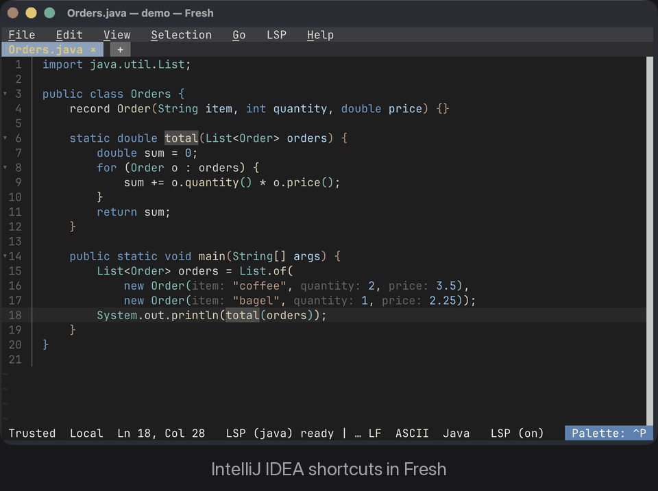

# IntelliJ keymap for Fresh

IntelliJ IDEA's macOS shortcuts for [Fresh](https://getfresh.dev), the terminal editor.

## Install

In Fresh: ⌃P → **Package: Install from URL** → `https://github.com/getsadzeg/fresh-intellij-keymap`

Needs macOS, Fresh 0.5.9 or newer, and a terminal that passes ⌘ to apps (Ghostty, kitty, WezTerm;
not Terminal.app). Using Ghostty? Do the [one-time setup](#ghostty-setup).

## Shortcuts

| Editing | Find & navigate | Code¹ |
|---|---|---|
| Save All `⌘S` | Replace `⌘R` | Go to Declaration `⌘B` |
| Delete Line `⌘⌫` | Find in Files `⌘⇧F` | Go to Implementation² `⌘⌥B` |
| Duplicate Line² `⌘D` | Replace in Files `⌘⇧R` | Find Usages `⌥F7` |
| Move Line Up / Down `⌥⇧↑` `⌥⇧↓` | Go to File `⌘⇧O` | Rename `⇧F6` |
| Matching Brace `⌃M` | Find Action `⌘⇧A` | Quick Documentation `F1` |
| Start / End of File `⌘Home` `⌘End` | Project panel `⌘1` | Completion `⌃Space` |
| …and select `⌘⇧Home` `⌘⇧End` | Problems panel `⌘6` | Parameter Info `⌘P` |
| Add Next Occurrence `⌃G` | Next / Previous Tab `⌘⇧]` `⌘⇧[` | Quick Fixes `⌥⏎` |
| Caret on Each Line `⌥⇧G` | Next / Previous Change `⌃⌥⇧↓` `⌃⌥⇧↑` | Reformat Code² `⌘⌥L` |
| Copy Path `⌘⇧C` | | Next / Previous Error `F2` `⇧F2` |
| | | File Structure `⌘F12` |

¹ Needs a language server for your language in Fresh. 
² Works slightly differently than in IntelliJ: ⌘D duplicates the whole line even when text is
selected, ⌘⌥L formats the whole file even when text is selected, and ⌘⌥B shows a list even when
there's only one result.

Undo/redo, cut/copy/paste, find, comment, ⌘L and word/line movement already work the IntelliJ way
in Fresh.

## Ghostty setup

Ghostty uses some ⌘ keys for its own features (⌘D splits the window, ⌘1 switches tabs…), and it
sends F1/F2 in a format Fresh doesn't read yet. Add [these lines](ghostty/config.ghostty) to
`~/.config/ghostty/config.ghostty` and reload Ghostty. Ghostty's features stay available in its
menu. To keep Ghostty's shortcuts instead, or for two optional tweaks, see
[Ghostty details](docs/ghostty.md).

## Not supported yet

Extend Selection, Toggle Case, Recent Files, Back / Forward, Start New Line, Join Lines, Search
Everywhere. [Why](docs/details.md#not-supported-yet)

## Uninstall

⌃P → **Package: Packages** → select fresh-intellij-keymap → **Uninstall**, then restart Fresh.

## How it's tested

Automated tests type every shortcut into a real Fresh, and every shortcut was also pressed in a real
Ghostty window. [Details](docs/testing.md)

## License

[MIT](LICENSE)
